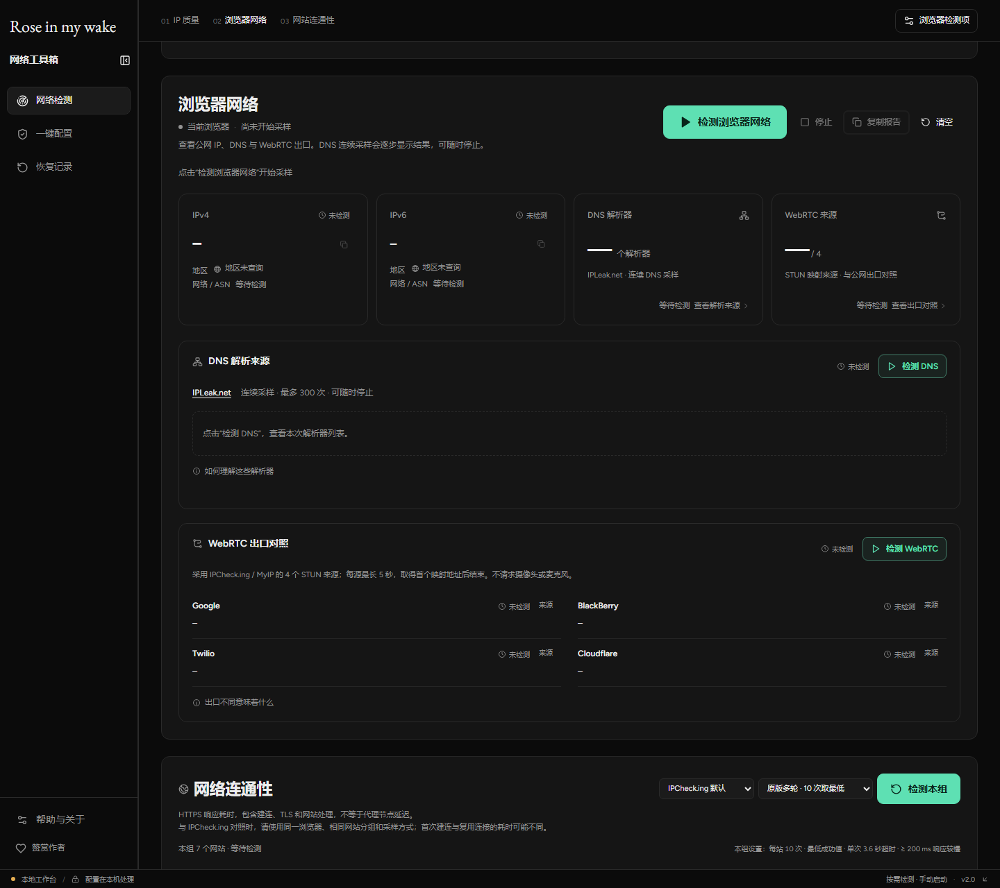
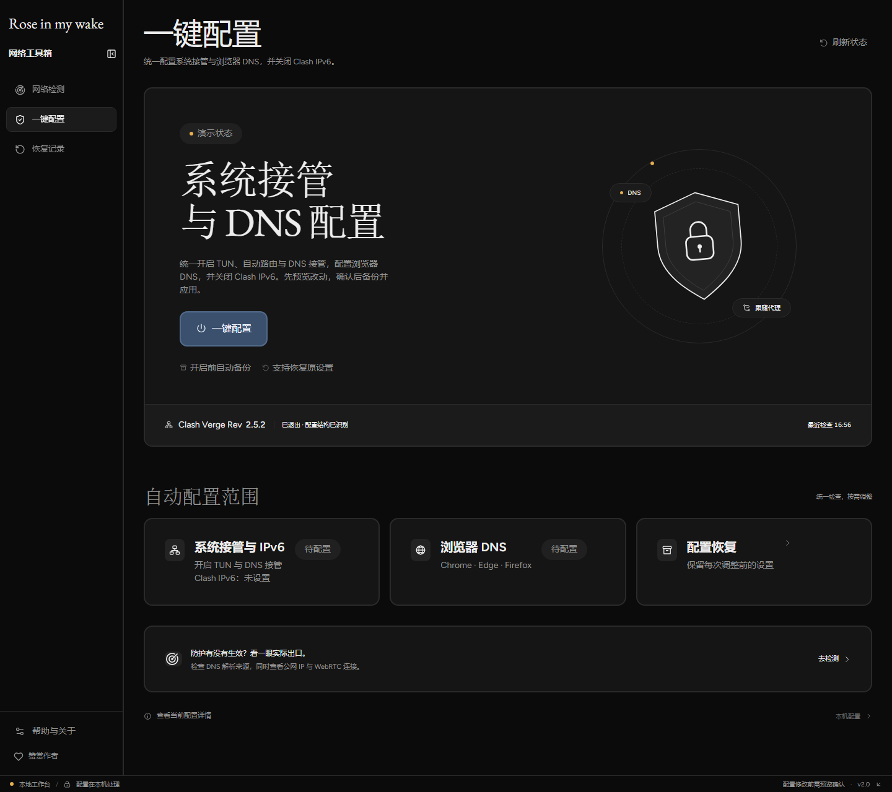
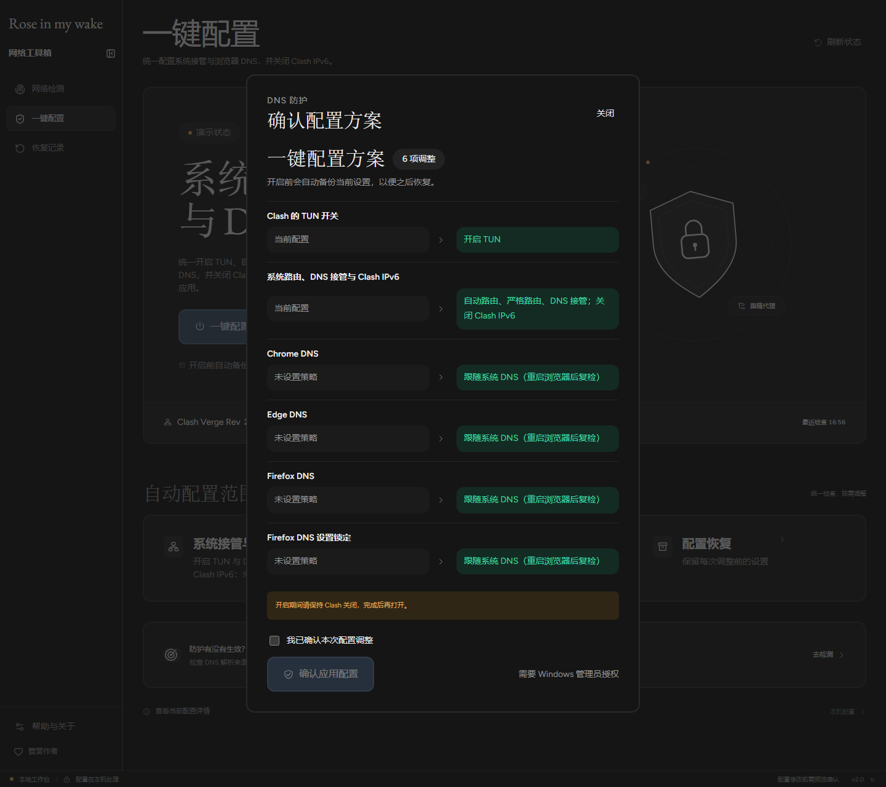
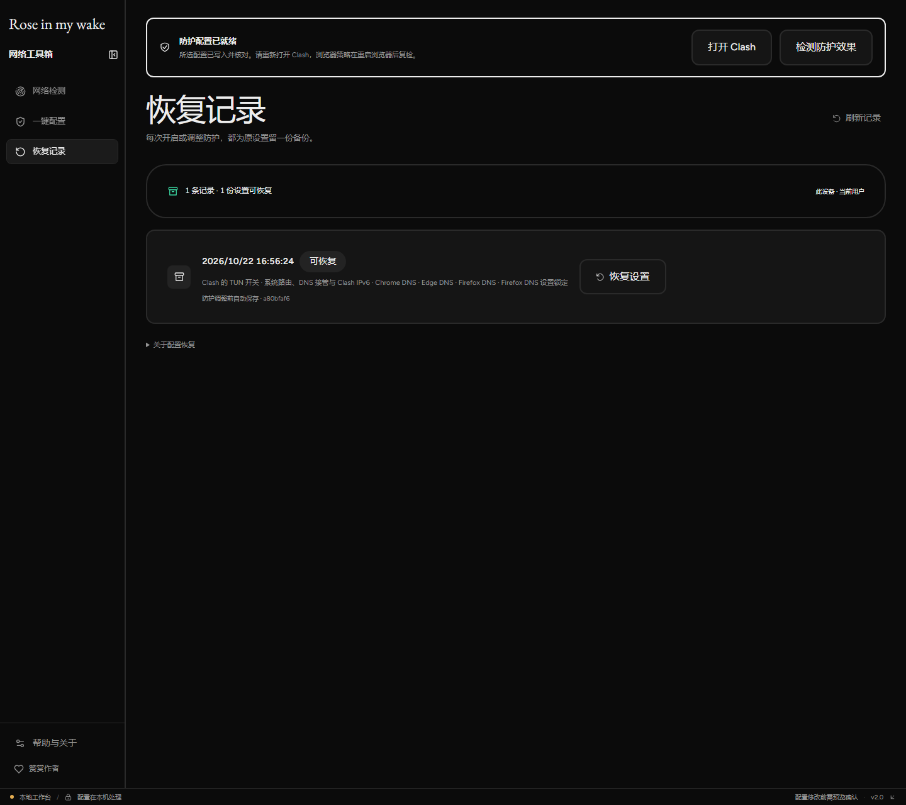

# Rose in my wake

一款 Windows 网络工具，帮你查看网络出口、检查网站连通性，并调整 Clash 与浏览器的 DNS 配置。

**Windows x64 · 2.0.0-preview.5（预览版）**

<!-- 发布新版本时，同步更新这里的版本号、两个按钮及下方表格的下载地址。 -->

  
  
  

首次使用可以选 **安装版**；不想安装可以选 **便携版**，完整解压后运行。

累计下载合计所有已发布版本（含预览版）的安装包和便携包，不含更新文件；每小时自动更新，显示可能有缓存延迟，不代表独立用户数。

[更新说明](https://github.com/Ytfelicity/BehindRose-v2/releases/tag/v2.0.0-preview.5) · [全部版本](https://github.com/Ytfelicity/BehindRose-v2/releases) · [快速上手](#快速上手) · [详细使用说明](docs/使用说明.md) · [反馈问题](https://github.com/Ytfelicity/BehindRose-v2/issues)

*当前开发版实际界面。网络检测尚未开始；下方配置和恢复截图使用程序自带的演示数据。已发布版本的布局可能略有不同。*

## 能做什么

- **查看网络出口**：检查公网 IP、DNS 解析来源与 WebRTC 地址。
- **检查网站连通性**：按分组检测常用网站，查看能否连接及响应耗时，也可以添加自己的网站。
- **查看 IP 质量**：查询当前出口的归属、风险系数，以及住宅 / 机房等类型信息。
- **配置与恢复**：为 Clash Verge Rev 和 Chrome、Edge、Firefox 生成配置方案，确认后应用，修改前自动备份。

## 下载与打开

适用于 **Windows x64**，目前为预览版。

点击顶部下载按钮，或在下表直接选择。历史版本与完整附件见 [GitHub Releases](https://github.com/Ytfelicity/BehindRose-v2/releases)。

| 你想怎么用 | 下载哪个文件 | 打开方式 |
| --- | --- | --- |
| 安装后使用 | [下载安装版（EXE）](https://github.com/Ytfelicity/BehindRose-v2/releases/download/v2.0.0-preview.5/BehindRose.NetworkAssistant-win-Setup.exe) | 双击安装，完成后打开程序 |
| 解压即用 | [下载便携版（ZIP）](https://github.com/Ytfelicity/BehindRose-v2/releases/download/v2.0.0-preview.5/BehindRose.NetworkAssistant-win-Portable.zip) | 完整解压，运行 `current/BehindRose.exe` |

便携版也可运行 `current/BehindRose.exe`。请保留完整目录，不要只取出一个 EXE。`Source code` 是源码，`.nupkg` 等附件供程序更新使用，首次使用下载上表中的文件即可。

普通双击启动主程序即可，应用配置时会单独申请管理员权限。无需安装 .NET 或 Node.js；若提示缺少 WebView2，请安装 [Microsoft Edge WebView2 Runtime](https://developer.microsoft.com/microsoft-edge/webview2/)，再重新打开。

## 快速上手

### 1. 先看看当前网络

打开左侧 **网络检测**，按需要运行对应分区：

| 想知道什么 | 怎么操作 |
| --- | --- |
| 当前公网 IP、DNS 和 WebRTC 地址 | 在「浏览器网络」点击 **检测浏览器网络** |
| 哪些网站可以连接、响应有多快 | 在「网络连通性」选择网站分组，点击 **检测本组** |
| 当前出口的归属和风险情况 | 在「IP 质量体检」选择网络出口，点击 **开始质量体检** |

IP 质量可选择已有的 **本机 HTTP 代理**，或 **本机默认网络**。使用代理时，确认所选端口与客户端的 HTTP / 混合端口一致。

各分区需要手动开始。DNS 检测可能需要较长时间，可以中途停止并查看已取得的结果。检测结果只代表本次使用的网络出口；程序内置浏览器与日常浏览器的结果可能不同。

### 2. 需要调整配置时，再使用一键配置

这是我的默认配置，可以直接套用。**如果你已经做过特殊设置，请先自行备份完整配置，再考虑是否使用我的一键配置。**

**使用前请注意：**

- 会开启 Clash 的 **TUN、自动路由、严格路由与 DNS 接管**。虚拟机、多网卡或自定义路由场景，请先核对是否适合自己的环境。
- 会关闭 **Clash IPv6**，不关闭 Windows 网卡 IPv6。
- 会调整 **Chrome、Edge、Firefox 的 DNS 策略**，关闭浏览器独立的安全 DNS，让它们跟随系统 DNS；已有的相关自定义设置可能受到影响。
- 保留已有的 **节点、订阅、规则和上游 DNS**。程序会自动备份本次改动涉及的设置，但这不代替你对特殊配置的完整备份。
- 应用前会显示具体改动；无法识别配置时会说明原因，请先看完预览再确认。

**操作步骤：**

先安装并运行过 **Clash Verge Rev**，然后打开左侧 **一键配置**：

1. 点击 **一键配置**，查看即将修改的内容。
2. 从系统托盘退出 Clash。
3. 勾选 **我已确认本次配置调整**，点击 **确认应用配置**，完成 Windows 管理员授权。程序会先备份原设置。
4. 完成后重新打开 Clash，保存工作并重启相关浏览器，再回到网络检测确认效果。

查看一键配置与确认预览

**一键配置：先查看当前状态。**

**确认预览：逐项查看改动，再决定是否应用。**

### 3. 想撤销修改，打开恢复记录

进入 **恢复记录** → 选择对应记录的 **恢复设置** → 核对恢复范围 → 勾选确认 → 点击 **恢复原设置**。

如果相关配置后来又被改过，程序会停止恢复并提示冲突，避免覆盖后续设置。v1.9 的备份请使用原版本恢复。

查看恢复记录界面

## 常见问题

**需要自己准备代理客户端和订阅吗？** 需要。本工具不提供节点或订阅；自动配置面向可识别的 Clash Verge Rev 配置。

**检测失败就是网络泄漏吗？** 不能这样判断。超时、缺少 IPv6 或没有检测结果，都可能有其他原因；检测成功也不代表所有应用都不存在泄漏。

**配置和检测数据会发到哪里？** 配置与备份在本机处理。运行网络检测时，第三方检测服务会收到必要请求与来源 IP。分享详细网络报告前，请检查其中的地址信息。

**怎么更新或移除？** 支持更新的分发包会提示新版，确认后才下载更新。便携版删除程序目录即可移除程序；如果要撤销配置，请先在程序内恢复，删除程序不会自动还原设置。

## 更多说明

- [详细使用说明](docs/使用说明.md)：检测、配置、恢复与问题排查。
- [开发与技术说明](docs/开发与技术说明.md)：源码运行、构建、检测实现与验证记录。
- [安全说明](SECURITY.md) · [第三方来源与许可](THIRD_PARTY_NOTICES.md)。

项目自有代码采用 [BehindRose Noncommercial License 1.0](LICENSE)，允许非商业使用、修改和免费分发，**禁止商业用途**。这是源码公开（source-available）项目；第三方部分遵循各自许可。详见 [许可证说明](docs/许可证说明.md)。
